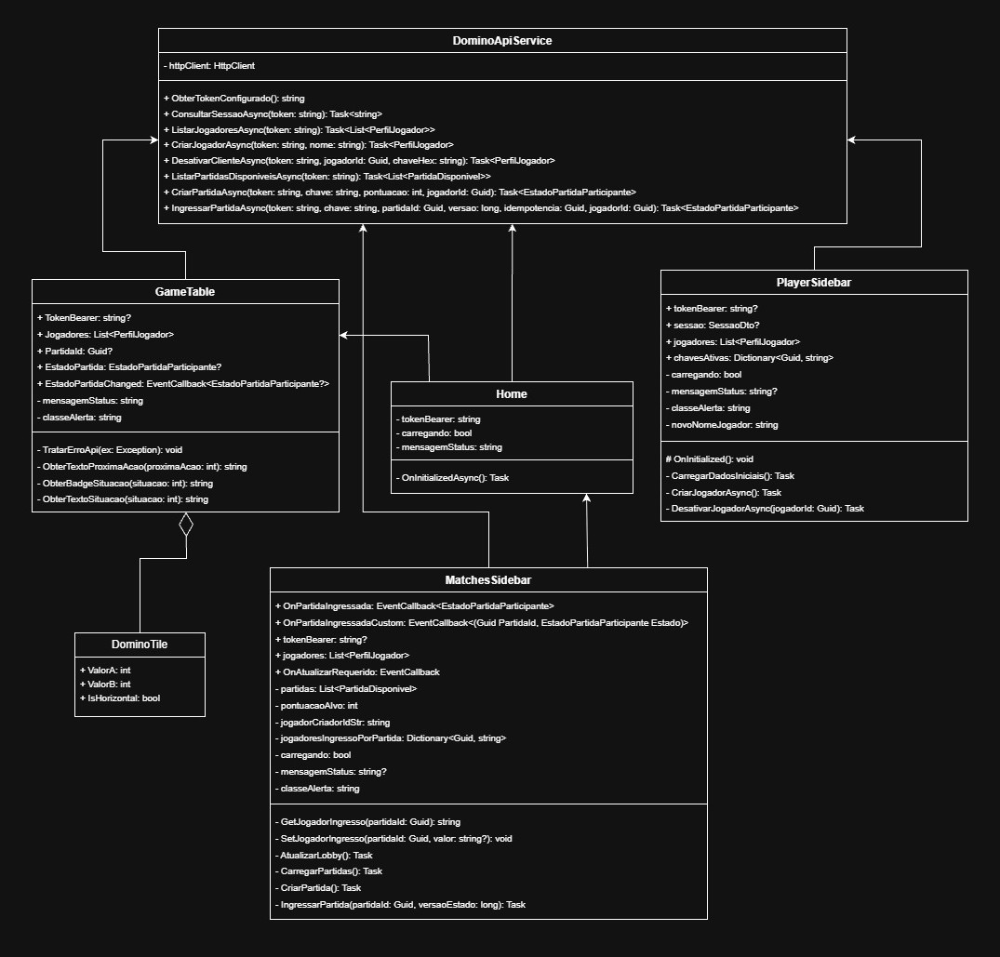

# Cliente Dominó Ponta de Quina

## Índice

| [Motivação](#motivação-do-projeto) | [Integrantes](#integrantes--3espg) | [Fluxo Comunicação](#fluxo-de-comunicação) | [Tecnologias](#estruturas-arquitetura-e-tecnologias) | [Endpoints](#endpoints-da-api) | [Como Executar](#como-executar-o-projeto) | [Evidências](#evidências-de-execução) |

---

## Motivação do Projeto

O projeto **Dominó** foi desenvolvido para fornecer uma plataforma completa de gerenciamento e simulação de partidas do jogo de dominó via Web. A aplicação foi desenvolvida em **Blazor WebAssembly / Server** (.NET) atuando como o cliente reativo que consome a API REST centralizadora, garantindo o correto fluxo de turnos, controle de estado, validação rigorosa de regras do jogo (como encaixe de peças nas extremidades e controle de compras no monte) e sincronização de dados entre múltiplos jogadores.

---

## Integrantes — 3ESPG
- João Victor Soave **(RM557595)**
- Maria Alice Freitas Araújo **(RM557516)**
- Pedro Henrique Mendes dos Santos **(RM555332)**
- Rafael Teofilo Lucena **(RM555600)**
- Vinicius Fernandes Tavares Bittencourt **(RM558909)**

---

## Fluxo de Comunicação
1. **Autenticação e Sessão:** O cliente consome o endpoint de sessão enviando um token do tipo Bearer (`Authorization: Bearer <token>`). A API valida a autorização e libera o acesso aos demais recursos da partida.
2. **Ativação e Chave de Jogador:** Para executar ações de partida (jogar, comprar, passar turno), o cliente envia a chave do jogador no cabeçalho customizado `X-Jogador-Ativacao`, garantindo a integridade e validação de permissão da jogada.
3. **Idempotência:** Ações de alteração de estado (como criação e ingresso em partidas) utilizam UUIDs no cabeçalho `X-Idempotency-Key` para evitar duplicidade de requisições.

---

## Estruturas, Arquitetura e Tecnologias

### Arquitetura de Componentes Blazor
A interface foi projetada utilizando uma arquitetura modular de componentes Blazor reutilizáveis e desacoplados:
- **`Home.razor`:** Página principal da aplicação que orquestra a layout global, integrando as sidebars e a mesa de jogo.
- **`GameTable.razor`:** Componente responsável por renderizar a mesa de jogo, o tabuleiro ativo, as mãos dos jogadores e os controles de ação (jogar, comprar, passar).
- **`MatchesSidebar.razor`:** Componente lateral destinado à listagem, criação e ingresso em partidas disponíveis no lobby.
- **`PlayerSidebar.razor`:** Componente responsável pela criação de novos perfis de jogadores, consulta de sessões ativas e desativação de cadastros.
- **`DominoTile.razor`:** Componente atômico para renderização visual das peças de dominó com suporte a orientação horizontal e vertical.

### Abstração e Injeção de Dependência (DI)
O acesso à API REST é isolado no serviço `DominoApiService`, injetado nativamente pelo contêiner de Injeção de Dependências do .NET. Isso garante testabilidade, manutenção simplificada e desacoplamento da camada de apresentação em relação à camada de infraestrutura de rede.

### Validação e Tratamento Defensivo de Erros
A aplicação implementa um manipulador centralizado de respostas HTTP que analisa falhas de negócio e lança exceções específicas (`InvalidOperationException`). Na interface, o método de captura `TratarErroApi` traduz mensagens de erro técnicas da API (como `ENCAIXE_INVALIDO` e `FORA_DO_TURNO`) em feedbacks visuais claros para o usuário através de alertas dinâmicos do Bootstrap.

### Controle de Estado Concorrente e Idempotência
A concorrência otimista é mantida enviando o campo `VersaoEstado` a cada ação realizada no tabuleiro. Se o estado da partida mudar no servidor antes do envio da jogada, a API rejeita a requisição, forçando o cliente a reatualizar a mesa antes de submeter uma nova ação.

| **Diagrama de Classes** |
| :---: |
|  |

---

## Como Executar o Projeto

### Pré-requisitos
- .NET SDK 8.0 ou superior instalado.
- Navegador moderno com suporte a HTML5 / WebAssembly.

### 1. Configurando a Aplicação
Abra o arquivo `appsettings.json` localizado na raiz do projeto e altere as strings para apontar para a URL da API REST de Dominó e seu token de acesso:

```json
{
  "URL_API": "https://sua-api-domino.com",
  "TOKEN_BEARER": "SEU_TOKEN_BEARER_AQUI"
}
```

### 2. Executando via Terminal
Navegue até o diretório raiz do projeto e execute os comandos:

```bash
# Restaura as dependências do projeto
dotnet restore

# Compila o projeto
dotnet build

# Executa a aplicação
dotnet run
```

Acesse a aplicação no navegador através do endereço indicado no terminal (ex: `https://localhost:5001`).

---

## Evidências de Execução

| **Partida Completa** |
| :---: |
https://github.com/user-attachments/assets/668437e0-5c21-4b3d-bdec-90ccb6f8c885

